  
  
  
  
  

🔴 Open the <a href="https://imranrasheeddeveloper.github.io"><b>live portfolio</b></a> and watch a swarm of cursors rebuild the whole site in front of you.

## ▍About me

- 🔴 **Senior Software Engineer (Full Stack)**, 8 years of experience since 2018
- 🧠 At **Turing** I build the engineering tooling behind **LLM and coding-agent evaluation** for frontier AI labs and enterprise clients, including Microsoft
- 🛠️ SWE-Bench / SWE-Bench+ tooling and dataset curation · code interpreter and function-calling eval · Swift ⇄ Python code translation · MCP integrations
- 🧩 Production depth in **Node.js (NestJS)**, **React**, **Vue**, **Python**, **Laravel**, Docker, PostgreSQL and AWS
- 🌍 Lahore, Pakistan · Remote, full time · **4+ hrs daily US overlap (EST / PST)** · Fluent English
- ⚡ I use Cursor, GitHub Copilot and Claude Code every day

## ▍Tech stack

**AI / LLM & Agents** 

**Languages** 

**Backend** 

**Frontend** 

**Data & DevOps** 

## ▍Experience

| Role | Company | When |
| :-- | :-- | :-- |
| 🔴 **Senior Full Stack Engineer / Team Lead** | Turing · Remote | Jul 2024 – Present |
| Full Stack Developer (Frontend Focused) | Coregenion GmbH · Remote | Feb 2023 – Jun 2024 |
| Full Stack Developer | Glorek · Lahore | Jun 2021 – Dec 2022 |
| Backend Engineer (APIs & Cloud Services) | ITRID Technologies · Lahore | Mar 2018 – May 2021 |

Turing programs: SWE-Bench+ Tooling · SWE-Bench Data · Penguin Code Translation · Penguin Code Interpreter · Penguin GUI · Penguin Function Calling · MCP · Microsoft Code Evaluation · Microsoft Codeforces

## ▍Featured projects

| Project | What it does | Links |
| :-- | :-- | :-- |
| 🔴 **SeekRemoteJobs** | AI-powered remote job aggregator that crawls 40+ top tech career pages (Puppeteer, Greenhouse, Lever, Workable). Gemini & Groq power resume parsing, tailoring, ATS scoring and job matching. React + Vite, Node.js, PostgreSQL, Docker. | [Live](https://seekremotejobs.com/) · [Code](https://github.com/imranrasheeddeveloper/seek-remote-jobs) |
| **ModelVault MiniVault API** | LLM prompt/response API with real-time token streaming, local LLMs via Ollama, Prometheus `/metrics`, JSONL logging and a Python CLI. | [Code](https://github.com/imranrasheeddeveloper/modelvault-mini-vault) |
| **SecureNest VPN** | Backend for a secure VPN service: network routing, handshake validation and infrastructure bridges over WireGuard. | [Code](https://github.com/imranrasheeddeveloper/SecureNestVPN) |
| **Motion Detector** | Low-level C++ computer-vision utility for real-time motion detection. | [Code](https://github.com/imranrasheeddeveloper/MotionDetactor) |
| **Portfolio** | This red & black portfolio, which a swarm of cursors builds live. Vanilla JS, no build step. | [Live](https://imranrasheeddeveloper.github.io) · [Code](https://github.com/imranrasheeddeveloper/imranrasheeddeveloper.github.io) |

## ▍Let's build something

Open to **senior full-stack and AI / LLM engineering roles**: remote, full time, with 4+ hours of daily US overlap. 
📫 **imranrasheed.developer@gmail.com** · 📞 +92 308 4706656 · [LinkedIn](https://www.linkedin.com/in/imran-rasheed-145a971a2/)
