  
  
  
  
  

  
  

  
  

  <b>Open to senior full-stack and AI / LLM engineering roles</b>: remote, full time, with 4+ hours of daily US overlap. 
  📫 <a href="mailto:imranrasheed.developer@gmail.com">imranrasheed.developer@gmail.com</a> · 📞 +92 308 4706656 · <a href="https://www.linkedin.com/in/imran-rasheed-145a971a2/">LinkedIn</a> · <a href="https://imranrasheeddeveloper.github.io">Live portfolio</a>

Every section above is an animated SVG, built live by a swarm of cursors. The activity chart refreshes daily via GitHub Actions.

